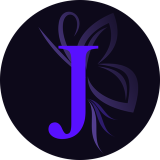
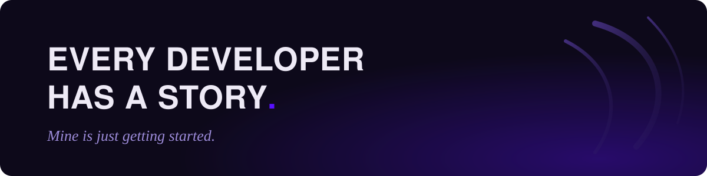

<div align="center">



# Tantely Jennifer

**Full-stack developer · Antananarivo, Madagascar**

*Technology, in service of people.*

<a href="https://portfolio-jennifer.vercel.app"></a>
<a href="https://www.linkedin.com/in/jennifer-rafatro-a1b5172a0/"></a>
<a href="https://github.com/JenniferTantely"></a>
<a href="mailto:jennifer.rafatro@gmail.com"></a>

<br />
<br />



</div>

## Who I am

I am a junior full-stack developer who builds robust, intuitive applications
designed around real needs. Curious and people-focused, I see code as a way to
create solutions that are useful and that mean something to the people who use
them.

```txt
curious  ->  builder  ->  problem solver
```

## Get to know me in one minute

A short video where I tell my story, in two languages. Both are published in
this repository's [releases](https://github.com/JenniferTantely/WhoAmI/releases).

| Version  | Title                          |
| -------- | ------------------------------ |
| English  | *Every developer has a story*  |
| Français | *Chaque développeur a une histoire* |

## Stack

<table>
  <tr>
    <td><strong>Frontend</strong></td>
    <td>
      
      
      
      
      
      
    </td>
  </tr>
  <tr>
    <td><strong>Mobile</strong></td>
    <td>
      
      
    </td>
  </tr>
  <tr>
    <td><strong>Backend</strong></td>
    <td>
      
      
      
      
      
    </td>
  </tr>
  <tr>
    <td><strong>Data</strong></td>
    <td>
      
      
      
      
    </td>
  </tr>
  <tr>
    <td><strong>Tools</strong></td>
    <td>
      
      
    </td>
  </tr>
</table>

## Selected projects

| Project                     | What it is                                                                 |
| --------------------------- | -------------------------------------------------------------------------- |
| **EventTrace**              | A social network built around events, so nobody spends a night alone in a crowd. Java, Spring Boot, Next.js, WebSocket. |
| **Lynx**                    | A platform connecting service providers with clients, from word of mouth to discovery. |
| **Tapakila**                | A ticketing app that makes the path from finding an event to holding a ticket as direct as possible. Next.js, Express, PostgreSQL. |
| **Wally**                   | A mobile expense tracker. I worked on transaction management and notifications. React Native, Expo. |
| **Weather for travel**      | Weather data analysis to find the best periods to travel, tailored to different traveller profiles. |

The full stories, with screenshots and demos, are on my
[portfolio](https://portfolio-jennifer.vercel.app).

## Education

- **Bachelor's degree in computer science**, third year · Haute Ecole d'Informatique Madagascar · 2023 - present
- **Scholarship awarded** · Haute Ecole d'Informatique · 2023
- **High school diploma, science track** · Lycée Analamahitsy · 2021 - 2023

<div align="center">
<br />

*Every story is built with others. Let's build the next chapter together.*

<a href="mailto:jennifer.rafatro@gmail.com"><strong>jennifer.rafatro@gmail.com</strong></a>

</div>
